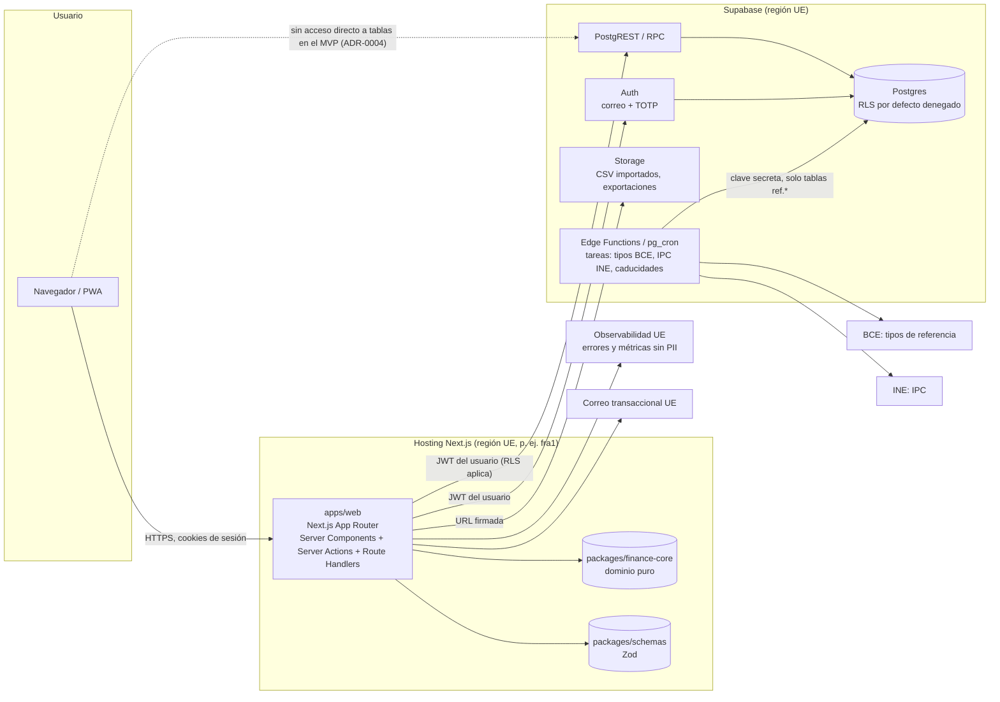

# 3. Arquitectura

## Diagrama de contexto y contenedores

## Componentes y responsabilidades

| Componente | Responsabilidad | Lo que NO hace |
|------------|-----------------|----------------|
| `apps/web` | UI, sesiones, orquestación, validación de entrada (Zod), llamada al dominio, cabeceras de seguridad | No contiene fórmulas financieras; no usa la clave secreta de Supabase |
| `packages/finance-core` | Aritmética decimal, XIRR, TWR, inflación, comisiones, proyecciones, hipoteca, escenarios de caída, motor de reglas de avisos | No conoce la UI, la base de datos, la red ni el reloj (la fecha "hoy" se le pasa) |
| `packages/schemas` | Esquemas Zod de entrada y salida compartidos; tipos derivados | No contiene lógica |
| `supabase/migrations` | Esquema, funciones, RLS, *grants*, *triggers* de auditoría e invariantes | — |
| `supabase/tests` | pgTAP: RLS, invariantes, funciones | — |
| Tareas programadas | Cargar tipos del BCE e IPC del INE, caducar invitaciones, purgar archivos y borrados | No tocan datos de usuarios salvo purgas definidas |

## Flujos de datos clave

### Lectura del panel
1. El navegador pide `/espacio/[id]/panel`. El *middleware* refresca la sesión (cookies `HttpOnly`, `Secure`, `SameSite=Lax`).
2. El Server Component crea un cliente Supabase **con el JWT del usuario**; RLS limita los datos al espacio.
3. Lee cuentas, patas, valoraciones, tipos de cambio e IPC; llama a `finance-core` con fecha "hoy" en la zona del espacio.
4. Devuelve las cifras **junto con su explicación** (entradas, supuestos, método).

### Escritura de un movimiento
1. Formulario → Server Action → validación Zod.
2. Llamada a una función RPC de Postgres (`create_transaction`) con privilegios del invocador (`security invoker`), que inserta la transacción y sus patas en una sola operación.
3. Un *trigger* diferido comprueba que las patas cuadran por moneda; si no cuadran, la operación entera se revierte.
4. Un *trigger* escribe el evento de auditoría.

### Importación CSV
1. Subida a Storage (*bucket* privado, ruta `space_id/…`, política de Storage por pertenencia) mediante URL firmada.
2. Server Action: hash SHA-256 del archivo → si existe el lote, se para. Si no, se analiza en el servidor con el mapeo guardado, se calcula la huella de cada fila y se muestra la vista previa.
3. Al confirmar: inserción en bloque con `ON CONFLICT DO NOTHING` sobre la huella única.

### Avisos
1. Tras cada cambio relevante (o al abrir el panel), el servidor calcula el estado con `finance-core.rules.evaluate(snapshot, assumptions, profile, flags)`.
2. Cada aviso nuevo o modificado se guarda con la regla, su versión, el hash de las entradas y la instantánea de supuestos.
3. Se muestra solo si su nivel está activado para el país y el espacio.

## Decisiones de arquitectura (ADR)

Todas están en [`docs/adr`](../adr/). Resumen:

| ADR | Decisión | Estado |
|-----|----------|--------|
| [0001](../adr/0001-registrar-decisiones.md) | Registrar decisiones con ADR | Aceptado |
| [0002](../adr/0002-nextjs-app-router.md) | Next.js App Router + TypeScript estricto, hosting en región UE | Propuesto |
| [0003](../adr/0003-supabase-ue.md) | Supabase en la UE para Postgres, Auth, Storage y tareas | Propuesto |
| [0004](../adr/0004-acceso-a-datos-y-rls.md) | Multitenencia por espacio, RLS en todo, acceso a datos solo desde el servidor en el MVP | Propuesto |
| [0005](../adr/0005-modelo-de-dinero.md) | Enteros en unidades mínimas + `numeric` para cantidades; aritmética decimal | Propuesto |
| [0006](../adr/0006-transacciones-con-patas.md) | Transacciones con patas (partida doble ligera) | Propuesto |
| [0007](../adr/0007-libreria-dominio-pura.md) | Librería de dominio pura con tests de propiedades | Propuesto |
| [0008](../adr/0008-importacion-idempotente.md) | Importación idempotente por hash de archivo y huella de fila | Propuesto |
| [0009](../adr/0009-auditoria-inmutable.md) | Auditoría en esquema propio, solo inserción y encadenada por hash | Propuesto |
| [0010](../adr/0010-motor-de-recomendaciones.md) | Motor de avisos por reglas versionadas con niveles y *flags* | Propuesto |
| [0011](../adr/0011-modulos-flags-i18n.md) | Módulos, *feature flags* e i18n | Propuesto |
| [0012](../adr/0012-cifrado-y-minimizacion.md) | Minimizar en lugar de cifrar campo a campo en el MVP | Propuesto |
| [0013](../adr/0013-monorepo-pnpm.md) | Monorepo con `pnpm` *workspaces*, sin orquestador adicional | Propuesto |

## Alternativas consideradas a tu preferencia de partida

| Alternativa | Por qué no (por ahora) |
|-------------|------------------------|
| Backend separado (NestJS, Fastify) + SPA | Más piezas, más superficie y más despliegues sin un beneficio claro a esta escala. Revisable si aparece una API pública. |
| Prisma/Drizzle con conexión directa a Postgres con un rol privilegiado | Pierde RLS como barrera (el ORM se conecta con un rol que salta RLS, salvo configuración cuidadosa). RLS es nuestra barrera principal de multitenencia. |
| Firebase / bases NoSQL | Sin transacciones relacionales fuertes ni `numeric`; mal encaje para un libro contable. |
| Autoalojar todo en la UE desde el día 1 | Más soberanía, pero más operación (copias, parches, alta disponibilidad). Queda como plan B si la pregunta 5 lo exige (ADR-0003). |

## Observabilidad

- **Logs estructurados** (JSON) con `request_id`, `user_id` seudonimizado (HMAC con secreto rotado), `space_id` seudonimizado, ruta y latencia. **Nunca** importes, descripciones de movimientos, correos ni tokens. Lista blanca de campos, no lista negra.
- **Errores**: proveedor con región UE y depuración de datos sensibles activada (`sendDefaultPii: false`, *scrubbing* de cuerpos y cabeceras). Sin *session replay*.
- **Métricas**: latencia p95 por ruta, errores 5xx, fallos de inicio de sesión, tasa de rechazos por límite de peticiones, duración de tareas programadas, edad del último tipo de cambio cargado.
- **Alertas**: picos de fallos de autenticación, 5xx por encima del umbral, tarea BCE/INE sin éxito en 48 h, fallo de copia o de prueba de restauración, cambio de rol a propietario.
- **Avisos de Supabase** (*Security Advisor* y *Performance Advisor*) revisados en CI o semanalmente: detectan tablas sin RLS y funciones con `search_path` mutable.

## Entornos

| Entorno | Base de datos | Datos | Despliegue |
|---------|---------------|-------|------------|
| Local | Supabase CLI (Docker) | Semilla ficticia generada | `pnpm dev` |
| Previsualización | Proyecto *staging* (o *branching* de Supabase si compensa su coste [A VERIFICAR]) | Ficticios | Cada PR |
| *Staging* | Proyecto Supabase dedicado (UE) | Ficticios | Rama `main` |
| Producción | Proyecto Supabase dedicado (UE), MFA obligatorio para administradores de la organización | Reales | Etiqueta de versión con aprobación manual |

Las migraciones se aplican en el orden local → *staging* → producción, siempre con `supabase db push` desde CI, nunca a mano desde el panel.
