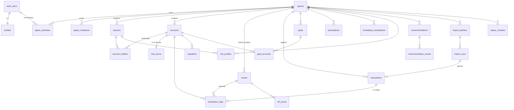

# 4. Modelo de datos

## Principios

1. **Toda tabla con datos de usuario lleva `space_id`** (salvo `profiles`, que es del usuario) y tiene RLS activada y forzada (`FORCE ROW LEVEL SECURITY`).
2. **Esquemas**:
   - `public`: tablas de negocio expuestas por la API, siempre con RLS.
   - `ref`: datos de referencia compartidos (monedas, tipos de cambio, IPC, parámetros fiscales). Lectura para `authenticated`; escritura solo para el rol de tareas.
   - `private`: funciones auxiliares de seguridad (`security definer`) y tablas internas. **No expuesto** en la API.
   - `audit`: registro de auditoría. No expuesto; solo inserción mediante funciones.
3. **Dinero**: `amount_minor bigint` + `currency char(3)` (ISO 4217). Cantidades de participaciones o unidades: `numeric(38,12)`. Precios: `numeric(28,10)`. Tipos de cambio: `numeric(20,10)`. Porcentajes: puntos básicos en `integer` (1 % = 100 pb) para umbrales y repartos. Ver ADR-0005.
4. **Fechas**: `date` para fechas contables (`occurred_on`, `as_of`); `timestamptz` para sellos técnicos. Cada espacio tiene `timezone` (IANA). Nunca se deriva una fecha contable de un `timestamptz` sin pasar la zona.
5. **Identificadores**: `uuid` (v7 si la versión de Postgres de Supabase lo trae de serie; si no, `gen_random_uuid()`) [A VERIFICAR].
6. **Borrado**: borrado real en el momento de borrar la cuenta; `archived_at` solo para ocultar en la UI. Sin borrado lógico "eterno".
7. **Enumerados** como tipos `enum` de Postgres solo cuando son estables (roles, tipo de pata); `text` + `check` cuando se prevé que crezcan (tipos de cuenta), para migrar sin bloqueos.

## Diagrama entidad-relación (núcleo)

## Tablas

> Columnas comunes no repetidas: `created_at timestamptz not null default now()`, `updated_at timestamptz` (mantenida por *trigger*), `created_by uuid references auth.users` donde tenga sentido.

### Identidad y multitenencia

**`profiles`**
| Columna | Tipo | Notas |
|---------|------|-------|
| `user_id` | `uuid` PK, FK `auth.users` `on delete cascade` | |
| `display_name` | `text` check longitud ≤ 80 | |
| `locale` | `text` default `'es-ES'` | BCP 47 |
| `timezone` | `text` default `'Europe/Madrid'` | Validada contra `pg_timezone_names` |

**`spaces`**
| Columna | Tipo | Notas |
|---------|------|-------|
| `id` | `uuid` PK | |
| `name` | `text` ≤ 80 | |
| `kind` | `text` check in (`personal`, `household`, `client`) | |
| `country_code` | `char(2)` default `'ES'` | Determina reglas fiscales y *flags* |
| `base_currency` | `char(3)` default `'EUR'` FK `ref.currencies` | |
| `timezone` | `text` default `'Europe/Madrid'` | |
| `plan` | `text` default `'personal'` | Para la fase 3 |

**`space_members`**: PK (`space_id`, `user_id`)
| Columna | Tipo | Notas |
|---------|------|-------|
| `role` | `enum app_role` (`owner`, `editor`, `viewer`, `advisor`) | |
| `expires_at` | `timestamptz` null | Obligatorio si `role = 'advisor'` (check) |
| `invited_by` | `uuid` | |
Restricción: *trigger* que impide dejar un espacio sin `owner`.

**`space_invitations`**
| Columna | Tipo | Notas |
|---------|------|-------|
| `id` | `uuid` PK | |
| `space_id` | `uuid` FK | |
| `email_normalized` | `citext` | Se borra al aceptar o caducar |
| `role` | `app_role` | |
| `token_hash` | `bytea` unique | SHA-256 de un token aleatorio de 256 bits; el token solo viaja en el enlace |
| `expires_at` | `timestamptz` | 72 h |
| `accepted_at`, `revoked_at` | `timestamptz` null | |
La aceptación se hace mediante una función RPC `accept_invitation(token)` (`security definer`, `search_path=''`) que comprueba el hash, la caducidad y que el correo del JWT coincide.

**`persons`** (titulares, no usuarios)
| Columna | Tipo | Notas |
|---------|------|-------|
| `id`, `space_id` | | |
| `display_name` | `text` ≤ 60 | |
| `kind` | `text` check in (`adult`, `minor`) | |
| `birth_year` | `smallint` null | Minimización: solo el año, opcional |
| `linked_user_id` | `uuid` null | Si el titular es también usuario |

### Cuentas y activos

**`accounts`**
| Columna | Tipo | Notas |
|---------|------|-------|
| `id`, `space_id` | | |
| `name` | `text` ≤ 80 | |
| `kind` | `text` check in (`current`, `savings`, `deposit`, `cash`, `brokerage`, `fund_holding`, `pension_plan`, `crypto`, `real_estate`, `vehicle`, `other_asset`, `mortgage`, `loan`, `credit_card`) | |
| `is_liability` | `boolean` generado a partir de `kind` | |
| `currency` | `char(3)` | |
| `institution_name` | `text` null | Texto libre en el MVP |
| `iban_last4` | `char(4)` null | Nunca el IBAN completo |
| `liquidity` | `text` check in (`immediate`, `days`, `months`, `illiquid`) | |
| `tax_wrapper` | `text` check in (`none`, `fund_transferable`, `pension_plan`, `pias`, `sialp`, `unit_linked`, `other`) | Parametrizable por país |
| `is_speculative` | `boolean` default false | Para el tope especulativo |
| `opened_on`, `closed_on` | `date` null | |
| `archived_at` | `timestamptz` null | |

**`account_holders`**: PK (`account_id`, `person_id`); `share_bps integer check (share_bps between 1 and 10000)`; *trigger* diferido: la suma por cuenta es 10000.

**`loan_terms`** (1:1 con cuentas de deuda)
| Columna | Tipo |
|---------|------|
| `account_id` PK | `uuid` |
| `principal_minor` | `bigint` |
| `rate_type` | `text` (`fixed`, `variable`, `mixed`) |
| `annual_rate` | `numeric(9,6)` (TIN como fracción) |
| `index_name`, `spread` | `text`, `numeric(9,6)` null |
| `term_months` | `integer` |
| `start_on`, `first_payment_on` | `date` |

**`assets`** (`space_id` null = catálogo global de solo lectura, cargado por nosotros)
| Columna | Tipo | Notas |
|---------|------|-------|
| `kind` | `text` (`equity`, `etf`, `mutual_fund`, `pension_fund`, `bond`, `crypto`, `real_estate`, `commodity`, `other`) | |
| `name` | `text` | |
| `isin` | `char(12)` null, check de dígito de control (función) | |
| `ticker`, `mic` | `text` null | |
| `currency` | `char(3)` | |
| `asset_class` | `text` (`equity`, `fixed_income`, `cash`, `real_estate`, `crypto`, `commodity`, `mixed`) | Para escenarios de caída |
| `equity_weight_bps` | `integer` null | Para fondos mixtos |
| `ter_bps` | `integer` null | Introducido por el usuario o de catálogo con fuente |
| `risk_indicator` | `smallint` null check 1-7 | Indicador SRI del documento de datos fundamentales, si se conoce |

### Libro de movimientos (ADR-0006)

**`transactions`**
| Columna | Tipo | Notas |
|---------|------|-------|
| `id`, `space_id` | | |
| `kind` | `text` check in (`contribution`, `withdrawal`, `internal_transfer`, `buy`, `sell`, `dividend`, `interest`, `fee`, `tax`, `fund_switch`, `loan_payment`, `income`, `expense`, `opening_balance`, `adjustment`) | |
| `occurred_on` | `date` | Fecha valor en la zona del espacio |
| `description` | `text` ≤ 200 null | Minimizada en la importación |
| `reverses_id` | `uuid` null FK self | Corrección por inversión |
| `import_row_id` | `uuid` null | |

**`transaction_legs`**
| Columna | Tipo | Notas |
|---------|------|-------|
| `id` | `uuid` PK | |
| `transaction_id` | `uuid` FK `on delete cascade` | |
| `space_id` | `uuid` | Redundante a propósito: RLS directa e índice; *check* por *trigger* de que coincide con la transacción |
| `account_id` | `uuid` null | Null solo si `role` es `external`, `fee` o `tax` (flujos que entran o salen del espacio); en `fee` y `tax` se guarda en `charged_account_id` la cuenta de la que se cobró, para poder atribuir el coste |
| `charged_account_id` | `uuid` null | Solo para `fee` y `tax` |
| `role` | `enum leg_role` (`cash`, `position`, `external`, `fee`, `tax`) | |
| `asset_id` | `uuid` null | Obligatorio si `role = 'position'` |
| `quantity` | `numeric(38,12)` null | Unidades del activo (positiva = entra) |
| `amount_minor` | `bigint` | Importe con signo en `currency` |
| `currency` | `char(3)` | |
| `fx_rate_to_base` | `numeric(20,10)` null | Tipo efectivamente aplicado si lo hubo |

**Invariante** (*constraint trigger* diferido al final de la transacción SQL): para cada `transaction_id` y `currency`, `sum(amount_minor) = 0`. Las operaciones con cambio de divisa usan dos patas `external` de conversión (una por moneda) con el tipo aplicado, de forma que cada moneda cuadra por separado.

Ejemplos:
| Operación | Patas |
|-----------|-------|
| Aportación de 1.000 € a un bróker | `external −100000 EUR`, `cash(bróker) +100000 EUR` |
| Traspaso interno de 500 € del banco al bróker | `cash(banco) −50000`, `cash(bróker) +50000` (sin pata externa) |
| Compra de 10 participaciones por 995 € + 5 € de comisión | `cash(bróker) −100000`, `position(bróker, fondo X, +10) +99500`, `fee +500` (el gasto sale del espacio) |
| Dividendo de 30 USD con 4,5 USD de retención | `external −3000 USD`, `cash +2550 USD`, `tax +450 USD` |
| Traspaso entre fondos (sin tributar) | `kind = fund_switch`; `position(fondo A, −n) −coste`, `position(fondo B, +m) +coste`; el coste fiscal se arrastra (lotes en la fase 2) |

**`valuations`**
| Columna | Tipo | Notas |
|---------|------|-------|
| `account_id` | `uuid` | |
| `asset_id` | `uuid` null | Null = valor de la cuenta completa |
| `as_of` | `date` | |
| `value_minor` | `bigint` | |
| `currency` | `char(3)` | |
| `source` | `text` (`manual`, `import`, `price_feed`, `computed`) | |
Único: (`account_id`, `coalesce(asset_id, cero)`, `as_of`).

### Referencia (`ref`)

| Tabla | Clave | Columnas clave | Fuente |
|-------|-------|----------------|--------|
| `ref.currencies` | `code` | `minor_units smallint` (EUR 2, JPY 0, BTC se trata como activo, no moneda) | ISO 4217 |
| `ref.fx_rates` | (`base`, `quote`, `as_of`) | `rate numeric(20,10)`, `source` | BCE, tipos de referencia diarios |
| `ref.inflation_index` | (`country`, `period date` primer día del mes) | `index_value numeric(12,4)`, `series_code`, `published_on` | INE, IPC general |
| `ref.prices` | (`asset_id`, `as_of`) | `price numeric(28,10)`, `currency`, `source` | Manual en el MVP; proveedor con licencia más adelante |
| `ref.tax_parameters` | (`country`, `fiscal_year`, `key`) | `value jsonb`, `source_url`, `verified_on`, `verified_by` | BOE / AEAT; cada valor con fuente |
| `ref.feature_flags` | (`key`, `scope_type`, `scope_value`) | `enabled`, `variant` | Interno |

### Planificación y avisos

| Tabla | Columnas principales |
|-------|----------------------|
| `goals` | `kind` (`emergency_fund`, `home_purchase`, `retirement`, `education`, `custom`), `name`, `target_minor`, `currency`, `target_on date`, `priority smallint`, `person_id null`, `params jsonb` validado con Zod y con un *check* de `jsonb_typeof` |
| `goal_accounts` | `goal_id`, `account_id`, `allocation_bps` |
| `assumptions` | `key` (`expected_return_equity`, `expected_return_bonds`, `expected_inflation`, `emergency_months`, `speculative_cap_bps`, `idle_cash_months`, `fee_alert_ter_bps`, `monthly_expenses_minor`…), `value numeric`, `unit`, `effective_from date`, `note`. Valores por defecto en código, con versión; el usuario los sobrescribe. |
| `scheduled_contributions` | `account_id`, `asset_id null`, `amount_minor`, `currency`, `rrule text` (subconjunto RFC 5545: FREQ, INTERVAL, BYMONTHDAY), `start_on`, `end_on null`, `active` |
| `risk_profiles` | `person_id`, `questionnaire_version`, `answers jsonb`, `horizon_years`, `capacity_score`, `tolerance_score`, `knowledge_score`, `completed_at`, `valid_until` |
| `recommendations` | `rule_id text`, `rule_version int`, `level smallint` (1-3), `severity` (`info`, `attention`, `important`), `status` (`active`, `dismissed`, `resolved`, `expired`), `inputs_hash bytea`, `inputs_snapshot jsonb` (solo agregados, no movimientos), `assumptions_snapshot jsonb`, `message_key text`, `message_params jsonb`, `confidence` (`high`, `medium`, `low`), `first_shown_at`, `dismissed_reason text null` |
| `recommendation_events` | `recommendation_id`, `event` (`shown`, `expanded`, `dismissed`, `resolved`, `feedback_useful`, `feedback_not_useful`), `user_id`, `at` |
| `budgets`, `categories` | Fase 2 |

### Importación

| Tabla | Columnas | Restricciones |
|-------|----------|---------------|
| `import_mappings` | `space_id`, `name`, `institution_hint`, `mapping jsonb` (columnas, formato de fecha, separador decimal, signo) | |
| `import_batches` | `account_id`, `file_sha256 bytea`, `storage_path`, `row_count`, `status` (`previewed`, `committed`, `reverted`), `mapping_id` | único (`space_id`, `account_id`, `file_sha256`) |
| `import_rows` | `batch_id`, `row_index`, `fingerprint bytea`, `status` (`new`, `duplicate`, `error`, `imported`), `error_code`, `transaction_id null` | único (`space_id`, `account_id`, `fingerprint`) solo para filas `imported` (índice parcial) |

Huella de fila: `SHA-256(account_id ‖ occurred_on ‖ amount_minor ‖ currency ‖ descripción normalizada ‖ saldo posterior si existe ‖ ordinal de ocurrencia)`. El ordinal distingue dos movimientos legítimamente idénticos el mismo día (por ejemplo, dos cafés de 2,50 €): es el número de veces que esa misma tupla aparece antes **dentro del archivo**. Ver ADR-0008 para sus límites.

### Módulos, auditoría y derechos

| Tabla | Notas |
|-------|-------|
| `space_modules` | (`space_id`, `module_key`, `enabled`). Módulos futuros con sus propias tablas prefijadas (`learn_*`, `mkt_*`) y las mismas reglas RLS |
| `audit.events` | `id bigint identity`, `occurred_at`, `actor_hash bytea`, `space_id`, `action`, `entity`, `entity_id`, `metadata jsonb` (sin PII ni importes), `ip_prefix_hash bytea`, `prev_hash bytea`, `hash bytea`. Ver ADR-0009 |
| `private.data_requests` | `user_id`, `kind` (`export`, `deletion`), `status`, `requested_at`, `completed_at` |

## Índices

| Tabla | Índice | Motivo |
|-------|--------|--------|
| `space_members` | (`user_id`, `space_id`) incluye `role`, `expires_at` | La función de RLS lo consulta en cada fila: debe ser solo índice |
| `accounts` | (`space_id`) where `archived_at is null` | |
| `transactions` | (`space_id`, `occurred_on desc`, `id`) | Historial y paginación por cursor |
| `transaction_legs` | (`account_id`, `transaction_id`); (`space_id`, `asset_id`) where `asset_id is not null`; (`transaction_id`) | Saldos por cuenta, posiciones, cuadre |
| `valuations` | (`account_id`, `as_of desc`) | Última valoración |
| `ref.fx_rates` | PK (`base`, `quote`, `as_of`) | Búsqueda "último ≤ fecha" |
| `recommendations` | (`space_id`, `status`) where `status = 'active'`; único (`space_id`, `rule_id`, `inputs_hash`) | No duplicar avisos |
| `import_rows` | índice parcial único de la huella | Idempotencia |
| Todas | `space_id` como primera columna o índice propio | RLS eficiente |

Las saldos agregados se calculan al vuelo en el MVP (volumen pequeño). Si un espacio supera ~50.000 patas o el p95 del panel pasa de 500 ms, se añade una vista materializada por cuenta y día, refrescada por *trigger* o tarea programada (decisión medible, no anticipada).

## Matriz de políticas RLS

Funciones auxiliares en `private`, `security definer`, `stable`, `set search_path = ''`, con `(select auth.uid())` para que Postgres lo evalúe una vez por consulta:

- `private.member_role(space uuid) returns app_role`: el rol vigente o null (excluye `advisor` caducado).
- `private.can_read(space)`: rol en (`owner`, `editor`, `viewer`, `advisor`).
- `private.can_write(space)`: rol en (`owner`, `editor`).
- `private.is_owner(space)`: rol = `owner`.
- Requisito AAL2: `private.is_aal2()` lee `auth.jwt()->>'aal'`; se exige en operaciones marcadas, si el usuario tiene MFA activado (y, en la fase 3, siempre para propietarios).

Leyenda: **S** select, **I** insert, **U** update, **D** delete. "—" denegado. Por defecto, `anon` no tiene *grants* sobre ninguna tabla (`revoke all … from anon`).

| Tabla | Propietario | Editor | Solo lectura | Asesor invitado (vigente) | Observaciones |
|-------|-------------|--------|--------------|---------------------------|---------------|
| `profiles` | S U propio | S U propio | S U propio | S U propio | Los demás miembros ven solo `display_name` mediante una vista |
| `spaces` | S U D(AAL2) | S | S | S | Inserción mediante RPC `create_space` que crea a la vez la membresía de propietario |
| `space_members` | S I U D (AAL2) | S | S | S (solo su fila) | No puede degradar al último propietario; el asesor no ve el resto de miembros |
| `space_invitations` | S I U(revocar) | — | — | — | Aceptar solo mediante RPC |
| `persons` | S I U D | S I U D | S | S | |
| `accounts`, `account_holders`, `loan_terms` | S I U D | S I U D | S | S | |
| `assets` (propios) | S I U D | S I U D | S | S | Catálogo global (`space_id` null): S para `authenticated` |
| `transactions`, `transaction_legs` | S I U D | S I U D | S | S | Escritura mediante RPC; U/D solo en las primeras 24 h, después por inversión |
| `valuations` | S I U D | S I U D | S | S | |
| `goals`, `goal_accounts`, `assumptions`, `scheduled_contributions` | S I U D | S I U D | S | S | |
| `risk_profiles` | S I U D | S I U D (de titulares) | S | S | |
| `recommendations` | S U(estado) | S U(estado) | S | S | Inserción solo por el servidor mediante RPC que valida el nivel con *flags* |
| `recommendation_events` | S I | S I | S I | S I | Solo inserción; sin U/D |
| `import_*` | S I U D | S I U D | S | — | El asesor no ve archivos importados |
| `space_modules` | S U | S | S | — | |
| `ref.*` | S | S | S | S | Escritura solo con el rol de tareas |
| `audit.events` | S (de su espacio, mediante vista) | — | — | — | Sin U/D para nadie, ni siquiera el propietario de la tabla de la aplicación |
| Storage `imports` | S I D en `space_id/…` | S I D | — | — | *Bucket* privado; URL firmada de corta duración |
| Storage `exports` | S (propias, AAL2) | — | — | — | Borrado automático a las 24 h |

**Pruebas pgTAP obligatorias por tabla** (generadas con una plantilla):
1. RLS activada y forzada (`relrowsecurity` y `relforcerowsecurity`).
2. `anon` no puede S/I/U/D.
3. Un usuario sin membresía no ve ninguna fila de otro espacio, incluso conociendo el `id`.
4. Cada rol puede exactamente lo de la matriz y nada más.
5. El asesor caducado (`expires_at` en el pasado) no ve nada.
6. Un `insert` con `space_id` ajeno falla (`with check`).
7. Un `update` que intenta cambiar `space_id` a otro espacio falla.
8. Un test de **meta-cobertura**: la lista de tablas de `public` con RLS forzada debe ser igual a la lista de tablas de `public`; una tabla nueva sin política rompe el CI.

## Diccionario de datos

Se genera automáticamente desde los `COMMENT ON` de las migraciones a `docs/datos/diccionario.md` en CI, de forma que nunca se desincroniza. Cada columna con datos personales lleva una etiqueta en el comentario (`[pii]`, `[financiero]`, `[menor]`) que alimenta el registro de actividades de tratamiento y la exportación RGPD.
