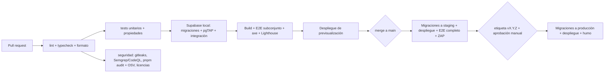

# 9. Calidad, CI/CD y entornos

## Estándares de código

- TypeScript `strict: true` + `noUncheckedIndexedAccess`, `exactOptionalPropertyTypes`, `noImplicitOverride`.
- ESLint (configuración plana) con `typescript-eslint` en modo estricto con tipos, `eslint-plugin-security`, reglas propias: prohibido `dangerouslySetInnerHTML`, prohibido `number` en tipos de dinero de `finance-core` (lint por nombre o tipo de marca), prohibido importar la clave secreta o el cliente de servicio en `apps/web`, prohibido `Date.now()`/`new Date()` en `finance-core`.
- Prettier para el formato. Commits convencionales (`feat:`, `fix:`…) comprobados en CI.
- Revisión de código obligatoria en `main` (aunque trabajes solo, pasa por PR; Claude Code puede actuar como revisor adicional con `/code-review` y `/security-review`).
- *Definition of done* de cada historia: tests, documentación actualizada (ADR o diccionario si aplica), accesibilidad comprobada, sin regresiones de RLS.

## Pirámide de tests

| Nivel | Herramienta | Alcance | Cuándo |
|-------|-------------|---------|--------|
| Unitarios de dominio | Vitest + fast-check (+ Stryker semanal) | `finance-core`, `schemas` | Cada commit; 100 % de cobertura en `finance-core` |
| Unitarios de la web | Vitest + Testing Library | Componentes con lógica, utilidades, *logger* | Cada PR |
| Base de datos | pgTAP con `supabase test db` | RLS por tabla y rol, invariantes (cuadre, propietario, titularidad), funciones RPC, auditoría | Cada PR (Supabase local en CI) |
| Integración | Vitest contra Supabase local | Server Actions → RPC → base de datos con usuarios reales de prueba | Cada PR |
| Extremo a extremo | Playwright + axe-core | Flujos críticos (abajo) en Chromium y WebKit móvil | Cada PR (subconjunto) y diario (completo) en *staging* |
| Seguridad dinámica | OWASP ZAP *baseline* | Cabeceras, configuración | Semanal contra *staging* |
| Rendimiento | Lighthouse CI | Presupuestos de LCP y JS | Cada PR en las rutas principales |

**Flujos E2E críticos**: registro + MFA; crear espacio e invitar; aceptar invitación y comprobar el rol; dos usuarios en dos espacios que no se ven (intento de acceso por URL y por API); alta de cuentas y movimientos; traspaso interno que no altera la rentabilidad; importación + reimportación sin duplicados + deshacer; panel cuadrado al céntimo con un escenario conocido; objetivo de vivienda; aviso con explicación; exportar con AAL2; borrar cuenta y comprobar que no queda nada.

**Datos de prueba**: generador de datos ficticios determinista (semilla) con los perfiles de la sección 1. **Prohibido** usar extractos reales en el repositorio o en *staging*; los *fixtures* de importación de cada entidad se fabrican a mano con el formato real y datos inventados.

## CI/CD con GitHub Actions

Reglas:
- Acciones de terceros fijadas por SHA de commit; `permissions:` mínimos por *workflow* (`contents: read` por defecto); OIDC o secretos de entorno con aprobadores para producción.
- Ramas protegidas: `main` exige CI verde, revisión y historial lineal; nadie empuja directamente.
- Las migraciones se ejecutan **antes** de desplegar el código y deben ser compatibles hacia atrás con la versión anterior (patrón expandir/contraer), de modo que desplegar sea reversible.
- Reversibilidad: cada migración va acompañada de una migración inversa probada en CI (aplicar → revertir → aplicar) cuando sea posible; las destructivas (borrar columnas) se hacen en dos versiones separadas. Supabase no ejecuta migraciones "down" por sí mismo, así que la reversa se escribe como una nueva migración hacia delante; se guarda el *script* preparado junto a la original [RECOMENDACIÓN].
- *Dependabot*/Renovate semanal, agrupado, con CI completo.
- SBOM (CycloneDX) generado en cada versión.
- Tras desplegar en producción: pruebas de humo (salud, inicio de sesión de una cuenta sintética en un espacio sintético, cabeceras).

## Entornos

| | Local | Previsualización | *Staging* | Producción |
|-|-------|------------------|-----------|------------|
| Supabase | CLI en Docker | Proyecto de *staging* o rama de Supabase | Proyecto propio (UE) | Proyecto propio (UE) |
| Datos | Semilla ficticia | Semilla ficticia | Semilla ficticia + usuarios sintéticos | Reales |
| Secretos | `.env.local` (no versionado) | Entorno del hosting "preview" | Entorno "staging" | Entorno "production" con aprobación |
| Correo | Captura local (Inbucket/Mailpit del CLI) | Sandbox | Sandbox | Real |
| Acceso | Tú | Equipo | Equipo | Mínimo; MFA; registrado |

## Documentación viva

- `docs/adr/`: decisiones.
- `docs/arquitectura.md`: diagramas Mermaid (contexto, contenedores, flujos) revisados en cada fase.
- `docs/datos/diccionario.md`: generado desde los comentarios SQL.
- `docs/seguridad/matriz-permisos.md`: generada desde los tests pgTAP (la fuente de verdad es el test, no el documento).
- `docs/seguridad/asvs-checklist.md`: requisitos de nivel 2 con estado y evidencia.
- `docs/privacidad/`: EIPD, registro de actividades, retención.
- `CHANGELOG.md` generado desde los commits convencionales.
