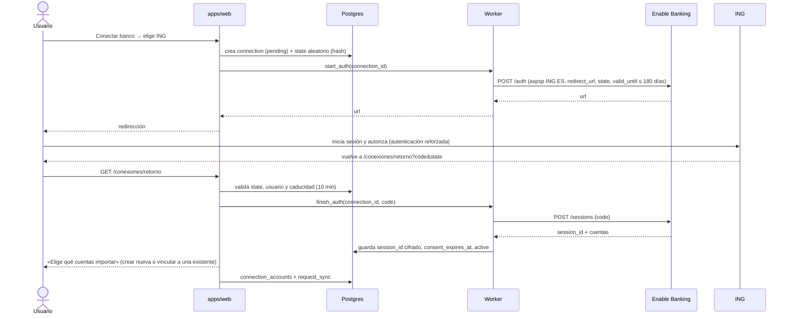

# 16. Integraciones: bancos, brókeres, exchanges y activos manuales

> Estado: **BORRADOR PARA APROBACIÓN** (2026-10-28). Decisión asociada: [ADR-0022](../adr/0022-conexiones-automaticas.md), propuesta.
> Sustituye a la propuesta que se dio en el chat el mismo día, basada en GoCardless. Convenciones del plan: **[HECHO]**, **[SUPUESTO]**, **[RECOMENDACIÓN]**, **[A VERIFICAR]**.

## 0. Qué cambia respecto a la primera propuesta

| Tema | Primera propuesta | Revisión | Motivo |
|------|-------------------|----------|--------|
| Agregador PSD2 | GoCardless (Nordigen) | **Enable Banking** | [HECHO] GoCardless no admite altas nuevas desde julio de 2025 ([aviso oficial](https://bankaccountdata.gocardless.com/new-signups-disabled), [Actual Budget](https://actualbudget.org/docs/advanced/bank-sync/gocardless/)). Enable Banking es proveedor de información sobre cuentas registrado ante el supervisor finlandés y ofrece «producción restringida» gratuita para las cuentas propias ([Open Banking Tracker](https://www.openbankingtracker.com/guides/free-open-banking-apis)) |
| Cola | `pgmq` | **Tabla `private.sync_jobs` con `FOR UPDATE SKIP LOCKED`** | Los tests de BD corren en un Postgres efímero sin Docker y sin `pgmq`; una tabla se prueba con pgTAP como el resto. El contrato de trabajo es el mismo, así que se puede pasar a `pgmq` más adelante |
| Dónde corre el worker | Edge Functions | **Edge Function en la fase 1, `apps/worker` en Railway más adelante** | [HECHO] Las Edge Functions no tienen IP de salida fija ([Supabase](https://supabase.com/docs/guides/troubleshooting/why-supabase-edge-functions-cannot-provide-static-egress-ips-for-whitelisting-3d78b0)); Binance recomienda lista blanca de IP. Railway (ya usado, ADR-0020) ofrece IP de salida fija en el plan Pro, quizá compartida con otros clientes ([Railway](https://docs.railway.com/networking/static-outbound-ips)) |
| Credenciales de Binance | El usuario pega la clave y el secreto; los ciframos | **Par Ed25519 generado por nosotros**: el usuario solo pega la clave **pública** en Binance | El secreto nunca viaja ni lo ve nadie; Binance admite claves autogeneradas Ed25519 ([Binance](https://developers.binance.com/docs/binance-spot-api-docs/faqs/api_key_types)) |
| eToro | Solo CSV/XLSX | **API pública** con clave de usuario, si da lectura de cartera | [HECHO] eToro publicó una API con claves por usuario ([portal](https://api-portal.etoro.com/getting-started)); [A VERIFICAR] qué permisos da la lectura de cartera |
| Trade Republic | CSV «según terceros» | **CSV oficial** (Transaktionsexport) | [HECHO] Disponible desde el 15-04-2026 en la app web ([foro de Portfolio Performance](https://forum.portfolio-performance.info/t/import-trade-republic-csv-transaktionsexport/39126), [Getquin](https://help.getquin.com/en/articles/14633614)) |
| Escritura en el libro | Implícita | **Cada sincronización es un lote de importación** (`import_batches`) | Reutiliza la idempotencia, la vista previa y la reversión de ADR-0008: un concepto por cosa (ADR-0018) |
| Fondos y planes de pensiones | — | **Manual asistido** hasta FiDA | No son cuentas de pago y PSD2 no los cubre. FiDA, el futuro reglamento europeo de acceso a datos financieros, no se ha retirado pero no tiene fecha de acuerdo ni de aplicación ([Thede Consulting, 07-2026](https://thede-consulting.com/en/payment-en/fida-back-in-motion-from-ambitious-to-workable/)) |

## 1. Dónde está el dinero y cómo conectar cada cosa

La forma del primer hogar está en [14-caso-de-referencia.md](14-caso-de-referencia.md) (sin datos reales). Lo que importa para conectar:

| Producto (forma) | Entidad | Vía más sencilla (ya) | Mejor vía posible | Qué aporta la mejor vía |
|------------------|---------|-----------------------|-------------------|-------------------------|
| Fondos mixtos y plan de pensiones | ING | Valoración manual mensual (10 s por cuenta) | Ninguna automática hoy (fuera de PSD2) | — |
| Cartera indexada y cuenta | MyInvestor | Valoración manual; aportaciones como movimientos | Cuenta de efectivo por PSD2 (Redsys) [A VERIFICAR en Enable Banking]; fondos, manual | Saldo y movimientos de la cuenta |
| Efectivo remunerado y cartera | Trade Republic | **CSV oficial** de transacciones | CSV para la cartera más PSD2 para la cuenta de efectivo [A VERIFICAR cobertura] | El efectivo, que es la mayor partida del caso, al día sin tocar nada |
| Bróker social | eToro | Extracto .xlsx | API de lectura con clave de usuario [A VERIFICAR alcance] | Posiciones y saldo diarios |
| Exchange de cripto | Binance | CSV del historial (tramos de 3 meses) | **API de solo lectura** con clave Ed25519 | Saldos diarios, depósitos y retiradas de euros |
| Cuentas de los menores | Varias | Valoración manual | PSD2 si son cuentas de pago | Saldo |
| Inmuebles, mutualidad | — | Alta manual más valoración con fuente | Igual (no hay fuente automática fiable) | — |

**Escalera de conexión** [RECOMENDACIÓN]:

1. **Manual** (ya existe): alta rápida con su valor de hoy.
2. **CSV/XLSX con plantilla por entidad** (ya existe el motor; faltan las plantillas): Trade Republic, Binance, eToro.
3. **API de solo lectura** sin contratos ni regulador: Binance; eToro si su lectura lo permite.
4. **PSD2 con Enable Banking** en producción restringida (gratis, solo cuentas propias): ING, MyInvestor y Trade Republic (cuentas de efectivo).
5. **SaaS**: contrato de producción completa con Enable Banking más KYB (verificación de la empresa), EIPD y dictamen legal (ver §7).

Para el rendimiento (aportado frente a ganado, XIRR, ADR-0021) basta con **los flujos externos y el valor actual**. El historial completo de compraventas es opcional. Por eso una API que solo da saldos y depósitos ya resuelve casi todo.

## 2. Stack, cola y límites de peticiones

### Stack (sin cambios de fondo)

- `apps/web` (Next.js) sigue siendo la única interfaz. Nunca habla con terceros financieros ni ve secretos.
- **Worker de sincronización**: un solo programa TypeScript con el mismo contrato de trabajos en dos alojamientos:
  - **Fase 1**: Edge Function `supabase/functions/sync-worker`, despertada por `pg_cron` cada minuto. No añade infraestructura y cumple la regla 3.
  - **Al abrir a otras personas o al pasar de ~50 conexiones** [SUPUESTO]: `apps/worker` en Railway (Ámsterdam) con IP de salida fija y un **rol de base de datos propio con permisos mínimos** en lugar de la clave secreta (ADR-0022, decisión pendiente).
- **Adaptadores por proveedor** en `packages/connectors` (nuevo, puro salvo el cliente HTTP inyectado): `enable-banking`, `binance`, `etoro`. Cada adaptador traduce la respuesta a filas normalizadas (`NormalizedRow` de `packages/importers`) y a valoraciones. Las fórmulas siguen en `finance-core`.

### Cola en Postgres

- `private.sync_jobs`: un trabajo por conexión y tipo (`sync`, `consent_check`), con `run_after`, `attempts` y `locked_until`.
- **Reclamo atómico**:
  ```sql
  update private.sync_jobs set state = 'running', locked_until = now() + interval '5 minutes', attempts = attempts + 1
  where id in (
    select id from private.sync_jobs
    where state = 'queued' and run_after <= now()
    order by run_after
    for update skip locked
    limit 10)
  returning *;
  ```
- **Un trabajo vivo por conexión**: índice único parcial `(connection_id, kind) where state in ('queued', 'running')`. Si el usuario pulsa «actualizar» dos veces, el segundo intento no encola nada.
- Un trabajo que cae a mitad vuelve a la cola cuando vence `locked_until`. La escritura es idempotente (§3), así que reintentar no duplica.

### Cómo no superar los límites de terceros

| Proveedor | Límite que manda | Medida |
|-----------|------------------|--------|
| Bancos vía PSD2 | [HECHO] Sin el usuario delante, el proveedor puede leer cada cuenta **como máximo 4 veces cada 24 h** (Reglamento Delegado (UE) 2018/389, art. 36.5) | Una sincronización diaria a una hora fija por conexión con desfase aleatorio (`sync_minute`) más «actualizar ahora» solo con el usuario presente (no gasta las 4 lecturas) y con un límite propio de 1 cada 15 min |
| Binance | [HECHO] Los límites son **por IP**, no por clave ([Binance](https://developers.binance.com/en/dev-docs/products/wallet/general-info)); todos los usuarios comparten la IP del worker | Cubo global dimensionado al 50 % del peso por minuto publicado [A VERIFICAR la cifra actual]. Se lee la cabecera de peso usado; `429` → espera `Retry-After`; `418` → se para todo Binance y se avisa |
| eToro | [A VERIFICAR] | Mismo patrón, con cubo por proveedor y por clave |

- **Cubo de fichas** en `private.rate_buckets(bucket, capacity, tokens, refill_per_sec, updated_at)` con `private.take_tokens(bucket, n) returns interval`: devuelve 0 si hay fichas o el tiempo de espera; si hay que esperar, el trabajo se reprograma con `run_after = now() + espera + jitter`.
- **Reintentos**: exponenciales (1, 5, 30 min, 3 h) solo ante 429/5xx/red. Un 401/403 no se reintenta: la conexión pasa a `needs_attention` y se avisa.
- **Precios compartidos**: el precio de un criptoactivo se pide una vez para todos (`ref.prices`, sin espacio) con la API pública de mercado, que no necesita clave [A VERIFICAR licencia de uso].
- **Escala**: con 1.000 usuarios y 3 conexiones cada uno salen ~3.000 trabajos diarios repartidos en 24 h, unos 2 por minuto. Una tabla con `SKIP LOCKED` y un solo worker lo soportan con mucho margen; el cuello de botella son los terceros, no la cola.

## 3. Modelo de datos

### Principio: los cuatro orígenes ya convergen

No hace falta un modelo «Portfolio» nuevo. El **espacio** es el inquilino y su cartera; las **cuentas** (`accounts`) son las posiciones agrupadas por entidad; los **bolsillos** (ADR-0017) son la vista del usuario. Todo origen termina en lo mismo:

| Origen | Movimientos | Valor | Procedencia visible |
|--------|-------------|-------|---------------------|
| Manual | `create_transaction` (`source = 'manual'`) | `valuations` (`source = 'manual'`) | «Lo escribiste tú» |
| CSV/XLSX | `import_commit` (`source = 'csv'`) | `valuations` (`source = 'csv'`, `import_batch_id`) | Archivo y fecha |
| API (Binance, eToro) | Lote de importación de la sincronización (`source = 'api'`) | `valuations` (`source = 'api'`) | Conexión y hora de la última sincronización |
| PSD2 (Enable Banking) | Ídem | Ídem | Ídem, más la caducidad del consentimiento |

### Tablas nuevas (borrador; la migración real sigue la skill `nueva-tabla`)

```sql
-- Conexión automática de un espacio con un proveedor. CSV y manual no son conexiones.
create table public.connections (
  id uuid primary key default gen_random_uuid(),
  space_id uuid not null references public.spaces (id) on delete cascade,
  institution_id uuid,
  kind text not null check (kind in ('psd2', 'api')),
  provider text not null check (provider in ('enable_banking', 'binance', 'etoro')),
  status text not null default 'pending' check (status in (
    'pending', 'active', 'needs_attention', 'expired', 'revoked')),
  consent_expires_at timestamptz,          -- PSD2: hasta 180 días
  sync_minute smallint not null default (floor(random() * 1440))::smallint
    check (sync_minute between 0 and 1439),
  last_success_at timestamptz,
  last_error_code text check (char_length(last_error_code) <= 40),
  created_by uuid references auth.users (id) on delete set null,
  created_at timestamptz not null default now(),
  updated_at timestamptz not null default now(),
  unique (id, space_id),
  foreign key (institution_id, space_id) references public.institutions (id, space_id)
    on delete set null (institution_id)
);

-- Qué cuenta del proveedor alimenta qué cuenta del espacio.
create table public.connection_accounts (
  connection_id uuid not null,
  space_id uuid not null references public.spaces (id) on delete cascade,
  account_id uuid not null,
  external_ref text not null check (char_length(external_ref) <= 100), -- id opaco del proveedor, nunca el IBAN
  created_at timestamptz not null default now(),
  primary key (connection_id, external_ref),
  unique (space_id, account_id),           -- una cuenta solo se alimenta de una conexión
  foreign key (connection_id, space_id) references public.connections (id, space_id) on delete cascade,
  foreign key (account_id, space_id) references public.accounts (id, space_id) on delete cascade
);

-- Secretos cifrados (§4). Esquema private: sin permisos para anon ni authenticated.
create table private.connection_secrets (
  connection_id uuid primary key,
  space_id uuid not null,
  ciphertext bytea not null,               -- AES-256-GCM(DEK, secreto), AAD = space_id ‖ connection_id ‖ versión
  nonce bytea not null check (octet_length(nonce) = 12),
  wrapped_dek bytea not null,              -- DEK cifrada con la KEK
  kek_version smallint not null,
  public_hint text,                        -- p. ej., huella de la clave pública Ed25519, para mostrarla
  created_at timestamptz not null default now(),
  foreign key (connection_id, space_id) references public.connections (id, space_id) on delete cascade
);

create table private.sync_jobs (
  id bigint generated always as identity primary key,
  connection_id uuid not null,
  space_id uuid not null,
  kind text not null check (kind in ('sync', 'consent_check')),
  state text not null default 'queued' check (state in ('queued', 'running', 'done', 'failed')),
  run_after timestamptz not null default now(),
  locked_until timestamptz,
  attempts smallint not null default 0,
  last_error_code text check (char_length(last_error_code) <= 40),
  foreign key (connection_id, space_id) references public.connections (id, space_id) on delete cascade
);
create unique index sync_jobs_live_idx on private.sync_jobs (connection_id, kind)
  where state in ('queued', 'running');
create index sync_jobs_ready_idx on private.sync_jobs (run_after) where state = 'queued';
```

Cambios aditivos en tablas existentes:

- `transactions.source` y `valuations.source` admiten `'api'`. Se cambia la restricción `check`, lo que solo amplía los valores permitidos.
- `import_batches`: `file_kind` admite `'api'` y la columna `connection_id` (FK compuesta). Para una sincronización, `file_sha256` es el SHA-256 de la respuesta canónica, de modo que la misma respuesta no se importa dos veces.
- Huella por fila: el **identificador de operación del proveedor** (ADR-0008, punto 3), por ejemplo `entry_reference` en PSD2 o el id de depósito en Binance.

### Aislamiento (RLS)

- `connections` y `connection_accounts`: `private.secure_space_table(..., p_read => 'peer')`. Las ven los miembros del espacio sin asesores; solo propietarios y editores las crean o borran. Un asesor no necesita saber qué proveedores usa el hogar.
- La columna `status` y las demás de estado **no** se conceden en `UPDATE` a `authenticated`: las cambia el worker o la RPC `revoke_connection`. El usuario solo puede pedir sincronizar (`request_sync`, que encola) o revocar.
- `private.*`: sin *grants* para `anon` ni `authenticated`. Solo las usan las funciones del worker.
- Tests pgTAP obligatorios (regla 1):
  - un usuario de otro espacio no ve ni modifica conexiones;
  - un `viewer`/`advisor` no crea conexiones;
  - `authenticated` no lee `private.connection_secrets` ni `private.sync_jobs`;
  - una `connection_accounts` no puede apuntar a una cuenta de otro espacio (`050-tenant-integrity`);
  - `request_sync` no crea dos trabajos vivos.

### Escritura desde el worker

El worker no tiene JWT de usuario, y `create_transaction` e `import_commit` usan `auth.uid()`. Se añade **una** función `private.ingest_sync(p_connection_id uuid, p_payload jsonb)`, `security definer` y ejecutable solo por el rol del worker, que:

1. comprueba que la conexión está `active` y que cada cuenta del *payload* está en `connection_accounts` de esa conexión;
2. crea el lote (`import_batches`, `file_kind = 'api'`) y sus `import_rows` con la huella del proveedor;
3. inserta las transacciones con la misma lógica que `import_commit`, extraída a una función interna común para no duplicarla, y las valoraciones del día;
4. registra el evento en `audit.events` y actualiza `last_success_at`.

Así la regla 5 se mantiene: el libro solo se escribe por RPC, y la reversión de un lote (`import_revert`) sirve también para deshacer una sincronización errónea.

## 4. Bóveda de credenciales

### Patrón: cifrado de sobre con la clave maestra fuera de la base de datos

- **KEK** (clave maestra): 256 bits en un secreto del worker (fase 1: secreto de la Edge Function; fase SaaS: KMS de la UE), con versión.
- **DEK** (clave por secreto): aleatoria, una por conexión; cifra el secreto con AES-256-GCM. La AAD (datos asociados) es `space_id ‖ connection_id ‖ kek_version`, de modo que un texto cifrado copiado a otra fila no se descifra.
- **En la base de datos** solo hay `ciphertext`, `nonce` y `wrapped_dek`. Una copia o un *dump* de la base no basta: hace falta además la KEK, que vive en otro sistema. Supabase Vault queda como alternativa más sencilla [RECOMENDACIÓN: no usarlo aquí] porque descifra dentro de la misma base de datos.
- **Rotación**: nueva `kek_version` y una tarea que vuelve a envolver las DEK; no hace falta descifrar los secretos.
- **Uso**: el worker descifra en memoria justo antes de firmar, no registra el valor (regla 8) y lo descarta al terminar el trabajo.

### Binance: el secreto nunca lo teclea nadie

1. El usuario elige «Conectar Binance». La acción exige AAL2 si tiene MFA (regla 10).
2. El servidor genera un **par Ed25519**, cifra la clave privada como arriba y muestra solo la **clave pública** con instrucciones:
   - en Binance → *API Management* → *Create API* → **Self-generated**;
   - pegar la clave pública;
   - marcar **solo lectura**;
   - opcional: restringir a la IP del worker cuando exista (fase SaaS).
3. El usuario pega en MyMoney la **API key** que le da Binance. Esa clave identifica, no firma, y se guarda cifrada igualmente.
4. Validación: el worker pide los permisos de la clave y **rechaza la conexión si permite operar o retirar**. La rechaza, no se limita a avisar.
5. Mantenimiento: la sincronización diaria mantiene la clave activa. [A VERIFICAR] Binance borra claves sin IP restringida tras un periodo de inactividad ([Binance Square](https://www.binance.com/en-BH/square/post/380736)).

Ventaja frente a «pegar la clave y el secreto»: el secreto no pasa por el navegador, el portapapeles, ni Binance; si alguien roba la base de datos, no obtiene nada que funcione sin la KEK.

### eToro y Enable Banking

- **eToro**: el usuario pega su *user key* de solo lectura; se guarda con el mismo sobre.
- **Enable Banking**: la aplicación se autentica con su propia clave privada (JWT firmado). Esa clave es un secreto **de la aplicación**, no del usuario, y vive solo en el worker. Por usuario solo se guarda el `session_id`, también cifrado: con él se leen las cuentas hasta que caduca el consentimiento.

## 5. Flujo PSD2 con Enable Banking (ING como ejemplo)



Detalles que importan:

1. **Antes de redirigir** se muestra:
   - qué se lee: saldos y movimientos, nunca el IBAN completo (se guardan como mucho 4 caracteres, ADR-0012);
   - que la app no puede mover dinero;
   - cuánto dura el permiso;
   - que se puede revocar en cualquier momento.
2. **`state`**: aleatorio de 32 bytes. En la base se guarda su hash, ligado al usuario y al espacio, de un solo uso y válido 10 minutos. Es la protección anti-CSRF del retorno.
3. **Vincular a una cuenta existente**: si el usuario ya tenía la cuenta de ING con valoraciones manuales, se enlaza en lugar de duplicarla. La primera sincronización trae movimientos desde la fecha que elija y no reescribe el pasado manual. Ofrecer «vincular» primero es la opción sencilla (regla 25).
4. **Caducidad**: un `consent_check` diario avisa 14 días antes de caducar, con un aviso de nivel 2 cuyo texto vive en `apps/web/src/messages/`, y ofrece «Renovar», que repite el flujo. Si caduca o el banco responde 401/403, la conexión pasa a `needs_attention`; los datos ya importados se conservan.
5. **Revocar**: borra la sesión en Enable Banking y el secreto, y deja la conexión `revoked`. Se pregunta si conservar o deshacer los lotes importados (`import_revert`).

## 6. Hoja de ruta de integraciones

| Paso | Contenido | Infraestructura nueva | Coste |
|------|-----------|-----------------------|-------|
| I-1 | Plantillas CSV/XLSX: Trade Republic, Binance, eToro (skill `importador-entidad`) | Ninguna | 0 |
| I-2 | Valoración rápida mensual para fondos y planes (ING, MyInvestor) con recordatorio | Ninguna | 0 |
| I-3 | Migración `connections`, `connection_accounts`, `private.connection_secrets`, `private.sync_jobs`, `private.rate_buckets`, `private.ingest_sync` con pgTAP | Ninguna | 0 |
| I-4 | Worker como Edge Function, `packages/connectors/binance`, flujo Ed25519 | `pg_cron` y una Edge Function | 0 |
| I-5 | Enable Banking en producción restringida: ING, MyInvestor y Trade Republic (cuentas de efectivo) | Alta en Enable Banking | 0 [A VERIFICAR condiciones] |
| I-6 | eToro por API, si la lectura de cartera está disponible con clave de usuario | Ninguna | 0 |
| I-7 (SaaS) | `apps/worker` en Railway con IP fija y rol de BD propio; contrato de producción con Enable Banking; EIPD específica; dictamen legal | Servicio Railway (Pro) | Railway Pro más el precio por volumen del agregador [A VERIFICAR] |

I-1 e I-2 dan el mayor valor con el menor esfuerzo y no dependen de nada. I-3 a I-6 son para uso propio. I-7 es la puerta para abrir a otras personas.

## 7. Riesgos y decisiones pendientes

| # | Tema | Opciones | Recomendación |
|---|------|----------|---------------|
| P1 | Rol del worker frente a la regla 3 («la clave secreta solo en `supabase/functions`») | (a) Edge Function con clave secreta; (b) Railway con un rol de BD que solo ejecuta `ingest_sync` y la cola | (a) en uso propio; (b) al abrir a otras personas, porque da menos privilegios que la clave secreta. Cambiar la regla 3 exige aceptar ADR-0022 y actualizar `AGENTS.md` |
| P2 | Legalidad del modelo SaaS | Operar bajo la licencia de Enable Banking, registrarse como proveedor de información sobre cuentas ante el Banco de España, o no ofrecer PSD2 | No ofrecer PSD2 a terceros hasta tener el dictamen (capítulo 7) y la oferta de Enable Banking por escrito |
| P3 | Cobertura real | Probar en el *sandbox* y con las cuentas propias | Antes de I-5, confirmar en Enable Banking que aparecen ING España, MyInvestor y Trade Republic [A VERIFICAR] |
| P4 | Conectores no oficiales de Trade Republic (por ejemplo, `pytr`) | Usarlos o no | **No**: piden las credenciales de acceso del usuario y rompen las condiciones del servicio; el CSV oficial basta |
| P5 | Precios de mercado | API pública del exchange frente a un proveedor con licencia | Exchange para cripto en uso propio; revisar la licencia antes de mostrar precios a terceros |

## Fuentes

- [GoCardless: altas nuevas desactivadas](https://bankaccountdata.gocardless.com/new-signups-disabled) · [Actual Budget: fecha del cierre](https://actualbudget.org/docs/advanced/bank-sync/gocardless/)
- [Open Banking Tracker: APIs gratuitas (Enable Banking, producción restringida)](https://www.openbankingtracker.com/guides/free-open-banking-apis) · [Enable Banking: API de información de cuentas](https://enablebanking.com/accounts-api/) · [Enable Banking: particularidades de España](https://enablebanking.com/docs/markets/es/)
- [Supabase: las Edge Functions no tienen IP de salida fija](https://supabase.com/docs/guides/troubleshooting/why-supabase-edge-functions-cannot-provide-static-egress-ips-for-whitelisting-3d78b0) · [Railway: IP de salida fija](https://docs.railway.com/networking/static-outbound-ips)
- [Binance: tipos de clave](https://developers.binance.com/docs/binance-spot-api-docs/faqs/api_key_types) · [Binance: límites por IP](https://developers.binance.com/en/dev-docs/products/wallet/general-info) · [Binance Square: borrado de claves sin IP](https://www.binance.com/en-BH/square/post/380736)
- [eToro: portal de la API](https://api-portal.etoro.com/getting-started)
- [Portfolio Performance: CSV de Trade Republic](https://forum.portfolio-performance.info/t/import-trade-republic-csv-transaktionsexport/39126) · [Getquin: exportación desde abril de 2026](https://help.getquin.com/en/articles/14633614)
- [Thede Consulting: estado de FiDA (julio de 2026)](https://thede-consulting.com/en/payment-en/fida-back-in-motion-from-ambitious-to-workable/)
- Reglamento Delegado (UE) 2018/389 (normas técnicas de autenticación reforzada), art. 36.5: límite de 4 accesos diarios sin el usuario presente.
